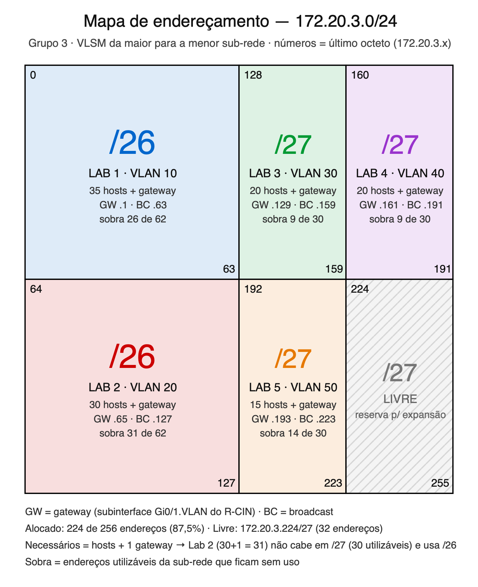

# E2 – Design de Endereçamento VLSM

Bloco do grupo 3: **172.20.3.0/24**, dividido em cinco sub-redes (uma por laboratório/VLAN), alocadas da maior para a
menor.

## Cálculo

Endereços necessários em cada sub-rede = **hosts + 1 gateway** (subinterface do R-CIN). Escolhe-se o menor bloco cujos
endereços utilizáveis (tamanho − 2, descontando rede e broadcast) comportem esse número.

| Lab | Hosts | Necessários (+GW) | Bloco | Prefixo | Utilizáveis |
| --- | ----- | ----------------- | ----- | ------- | ----------- |
| 1   | 35    | 36                | 64    | /26     | 62          |
| 2   | 30    | 31                | 64    | /26     | 62          |
| 3   | 20    | 21                | 32    | /27     | 30          |
| 4   | 20    | 21                | 32    | /27     | 30          |
| 5   | 15    | 16                | 32    | /27     | 30          |

O Lab 2 precisa de um /26: um /27 tem só 30 endereços utilizáveis, e são necessários 31 (30 PCs + gateway).

## Tabela VLSM

| Ordem | Lab (VLAN) | Sub-rede        | Máscara         | Gateway      | Broadcast    |
| ----- | ---------- | --------------- | --------------- | ------------ | ------------ |
| 1º    | Lab 1 (10) | 172.20.3.0/26   | 255.255.255.192 | 172.20.3.1   | 172.20.3.63  |
| 2º    | Lab 2 (20) | 172.20.3.64/26  | 255.255.255.192 | 172.20.3.65  | 172.20.3.127 |
| 3º    | Lab 3 (30) | 172.20.3.128/27 | 255.255.255.224 | 172.20.3.129 | 172.20.3.159 |
| 4º    | Lab 4 (40) | 172.20.3.160/27 | 255.255.255.224 | 172.20.3.161 | 172.20.3.191 |
| 5º    | Lab 5 (50) | 172.20.3.192/27 | 255.255.255.224 | 172.20.3.193 | 172.20.3.223 |
| —     | Livre      | 172.20.3.224/27 | 255.255.255.224 | —            | 172.20.3.255 |

O gateway é o primeiro endereço utilizável de cada sub-rede.

## Eficiência da alocação

Eficiência = endereços necessários (hosts + gateway) / tamanho do bloco.

| Lab   | Necessários | Bloco   | Eficiência |
| ----- | ----------- | ------- | ---------- |
| 1     | 36          | 64      | 56,25 %    |
| 2     | 31          | 64      | 48,44 %    |
| 3     | 21          | 32      | 65,63 %    |
| 4     | 21          | 32      | 65,63 %    |
| 5     | 16          | 32      | 50,00 %    |
| Total | 125         | 224     | **55,80 %** |

Cada lab recebeu o menor bloco possível: com um bit a menos de host, nenhuma sub-rede comportaria seus endereços.
Foram alocados 224 dos 256 endereços do /24, e o bloco 172.20.3.224/27 fica livre para expansão.

## Integrantes

| [ Marcos Alexandre (malb)](https://github.com/Lysanor) | [ Maria Clara (mcra2)](https://github.com/DianneK13) | [ Maria Luisa (mlas4)](https://github.com/airam00N) | [ Vitor Nascimento (vnb)](https://github.com/vThor27) |
| :---------------------------------------------------------------------------------------------------------------------------------------------------------: | :-------------------------------------------------------------------------------------------------------------------------------------------------------: | :------------------------------------------------------------------------------------------------------------------------------------------------------: | :--------------------------------------------------------------------------------------------------------------------------------------------------------: |
